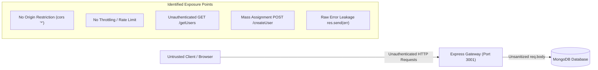

# Application Security Audit & Testing Plan (Vulnerability Assessment & Defense)

**Target Application:** Finance Management Web Application  
**Target Architecture:** MERN Stack (Node.js/Express, MongoDB/Mongoose, Vite/React)  
**Environment:** Localhost Testing Environment (`http://localhost:3001` - API, `http://localhost:5173` - Client)  
**Author / Security Auditor:** Parth Pandey  
**Methodology:** OWASP Top 10 (Web) / OWASP API Security Top 10 / NIST SP 800-115  

---

## 1. Executive Summary & Objective

This document establishes the security audit methodology, test cases, and evidence collection framework for auditing the **Finance Management WebApp**.

The objective of this assessment is two-fold:
1. **Pre-Remediation Assessment:** Conduct a controlled security evaluation against the local instance to identify architectural and code-level weaknesses (lack of authentication, missing rate limiting, CORS misconfigurations, input validation deficits, and error leakage).
2. **Defensive Engineering & Hardening:** Implement industry-standard security controls (Helmet, CORS policy, rate limiting, request validation, secure error handlers, and authentication mechanisms) and verify remediation with regression testing.

> **Note for Portfolio / Resume Documentation:**  
> Use the test cases and evidence templates in this document to record before/after findings for your portfolio and security report.

---

## 2. Localhost Test Environment Setup

Before performing any test cases, both the backend API and frontend client must be run locally in isolation.

### 2.1 Backend Initialization (`/server`)
```powershell
# Navigate to server directory
cd "d:\Parth All Stuf imp\All Project\Finance-Management-WebApp-main\server"

# Ensure dependencies are installed
npm install

# Verify .env exists with local or development MongoDB URI
# URL=mongodb://localhost:27017/finance_dev (or your dev cluster)

# Start backend server
node index.js
# Expected output: Server listening at 3001 & Database connected..
```

### 2.2 Frontend Initialization (`/client`)
```powershell
# Navigate to client directory
cd "d:\Parth All Stuf imp\All Project\Finance-Management-WebApp-main\client"

# Ensure dependencies are installed
npm install

# Start Vite development server
npm run dev
# Expected output: Local: http://localhost:5173
```

---

## 3. Threat Modeling & Attack Surface Analysis



### Attack Surface Breakdown:
1. **Perimeter / Transport Layer:** Absence of baseline security headers (`X-Frame-Options`, `Content-Security-Policy`, `HSTS`) and unrestricted CORS origins.
2. **API Endpoint Layer:** Publicly exposed endpoints without token validation, session verification, or user tenancy isolation.
3. **Data Ingestion Layer:** Absence of input schema validation and boundary constraints on `req.body`, exposing the data tier to mass assignment.
4. **Diagnostic / Error Handling Layer:** Direct transmission of raw internal runtime errors (`res.status(500).send(err)`), exposing database query errors and internals.

---

## 4. Security Vulnerability Test Matrix

| Test ID | Vulnerability Category | OWASP Mapping | Target Endpoint | Risk Level |
| :--- | :--- | :--- | :--- | :--- |
| **TEST-01** | Missing Authentication & Authorization (BOLA/IDOR) | OWASP API1:2023 / A01:2021 | `GET /getUsers`<br>`POST /createUser` | **High** |
| **TEST-02** | Security Misconfiguration: Permissive CORS | OWASP API7:2023 / A05:2021 | Global API (`cors()`) | **Medium** |
| **TEST-03** | Missing HTTP Security Headers | OWASP A05:2021 | Global Express Middleware | **Medium** |
| **TEST-04** | Unrestricted Resource Consumption (No Rate Limit) | OWASP API4:2023 / A04:2021 | `POST /createUser` | **Medium** |
| **TEST-05** | Mass Assignment & Input Validation Deficiency | OWASP API3:2023 / A03:2021 | `POST /createUser` | **High** |
| **TEST-06** | Information Disclosure via Unsanitized Error Handling | OWASP A05:2021 | `GET /getUsers`<br>`POST /createUser` | **Low / Info** |

---

## 5. Detailed Test Cases & Verification Procedures

### TEST-01: Broken Object Level Authorization & Missing Access Control
- **CWE:** CWE-306 (Missing Authentication for Critical Function)
- **Objective:** Verify whether unauthorized external clients can retrieve full financial records and submit financial transactions without an authenticated session or identity token.
- **Verification Procedure:**
  1. Send an unauthenticated HTTP `GET` request to `http://localhost:3001/getUsers`.
  2. Inspect response body for unauthenticated exposure of all stored transactions.
  3. Send an unauthenticated HTTP `POST` request to `http://localhost:3001/createUser` with arbitrary transaction parameters.
- **Expected Defensive State (Post-Hardening):**
  - Unauthenticated requests must receive HTTP `401 Unauthorized`.
  - Authorized requests must only return transactions belonging to the authenticated tenant/user ID.

---

### TEST-02: Overly Permissive Cross-Origin Resource Sharing (CORS)
- **CWE:** CWE-942 (Permissive Cross-Domain Policy with Untrusted Domains)
- **Objective:** Determine if the server accepts cross-origin requests from arbitrary, untrusted origins (`Access-Control-Allow-Origin: *`).
- **Verification Procedure:**
  1. Send an HTTP `OPTIONS` or `GET` request to `http://localhost:3001/getUsers` with the header `Origin: https://malicious-example.com`.
  2. Inspect response headers:
     - Check if `Access-Control-Allow-Origin` returns `*` or reflects the arbitrary origin.
- **Expected Defensive State (Post-Hardening):**
  - Origin must be restricted to explicitly whitelisted domains (e.g., `http://localhost:5173` or production frontend domain).
  - Unauthorized origins must be rejected or not receive permissive CORS headers.

---

### TEST-03: Security Header Posture Assessment
- **CWE:** CWE-1021 (Improper Restriction of Rendered UI Layers or Frames)
- **Objective:** Audit the baseline HTTP headers returned by Express to ensure protection against clickjacking, MIME-sniffing, and cross-site framing.
- **Verification Procedure:**
  1. Make an HTTP request to `http://localhost:3001/getUsers`.
  2. Audit response headers for the following standard defensive headers:
     - `X-Frame-Options` (DENY or SAMEORIGIN)
     - `X-Content-Type-Options` (nosniff)
     - `Content-Security-Policy` (CSP)
     - `Strict-Transport-Security` (HSTS)
     - Masking or removal of `X-Powered-By: Express`
- **Expected Defensive State (Post-Hardening):**
  - Helmet middleware attached to enforce standard headers and strip `X-Powered-By`.

---

### TEST-04: API Rate Limiting & Resource Consumption
- **CWE:** CWE-799 (Improper Control of Generation of Code or Resource Consumption)
- **Objective:** Evaluate whether repeated rapid requests can degrade service availability or result in database exhaustion.
- **Verification Procedure:**
  1. Dispatch a rapid batch of requests (e.g., 50-100 consecutive requests) to `http://localhost:3001/createUser`.
  2. Monitor whether the API accepts 100% of the requests without rate-limiting response codes (`429 Too Many Requests`).
- **Expected Defensive State (Post-Hardening):**
  - Configurable rate limiter (`express-rate-limit`) returns HTTP `429` with `Retry-After` header when request thresholds are exceeded.

---

### TEST-05: Mass Assignment & Strict Input Schema Validation
- **CWE:** CWE-915 (Improperly Controlled Modification of Dynamically Determined Object Attributes)
- **Objective:** Verify whether unexpected or malicious properties submitted in `req.body` are passed directly into `new UserModel(req.body)` and saved to the database.
- **Verification Procedure:**
  1. Submit a `POST` request with negative numbers, unexpected string types, or injected administrative attributes (e.g. `{ "isAdmin": true, "Amount": -99999 }`).
  2. Verify whether the schema rejects invalid data types or accepts unintended attributes.
- **Expected Defensive State (Post-Hardening):**
  - Strict input validation middleware (Zod/Joi or express-validator) whitelisting and validating strictly allowed fields and positive amount limits.

---

### TEST-06: Error Leakage & Diagnostic Exposure
- **CWE:** CWE-209 (Generation of Error Message Containing Sensitive Information)
- **Objective:** Verify if simulated database failures or malformed inputs return raw server stack traces or internal driver exceptions to the client.
- **Verification Procedure:**
  1. Trigger an internal database exception (e.g., passing invalid types or querying when DB connection is dropped).
  2. Verify if the client receives full Mongoose/Node stack traces in the response body.
- **Expected Defensive State (Post-Hardening):**
  - Generic client-safe error messages (`{ "error": "Internal Server Error" }`) returned to users, while detailed error logs remain strictly server-side.

---

## 6. POC Evidence Collection Template (For Word / Portfolio Report)

When documenting each vulnerability for your Word document report, use this standard professional structure:

```markdown
### Finding [ID]: [Vulnerability Title]
- Severity: [Critical / High / Medium / Low]
- CWE ID: [e.g. CWE-306]
- Affected Endpoint: [e.g. POST /createUser]
- Date Tested: [YYYY-MM-DD]
- Status: [Unpatched / Remediated]

#### 1. Vulnerability Description
[Explain the underlying root cause and theoretical impact on business logic or data integrity.]

#### 2. Test Evidence (Pre-Remediation)
- Request:
  [Insert HTTP Request with headers and payload]
- Response:
  [Insert HTTP Response code, response headers, and body]
- Screenshot:
  [Insert screenshot from Burp Suite / Postman / Browser DevTools]

#### 3. Defensive Remediation Applied
- Code Diff / Patch:
  [Provide before and after code snippet showing the defensive middleware or validation logic]

#### 4. Post-Remediation Verification
- Verification Request & Response:
  [Show the patched response, e.g. 401 Unauthorized, 429 Too Many Requests, or 400 Bad Request]
- Result: [Vulnerability Mitigated]
```

---

## 7. Security Hardening Roadmap (Implementation Sequence)

1. **Step 1: Baseline Audit & Evidence Capture**
   - Run the pre-remediation tests using curl / Postman / browser developer tools on localhost.
   - Record screenshots and HTTP payloads into your Word evidence file.
2. **Step 2: API Perimeter & Header Hardening**
   - Install and configure `helmet` for security headers.
   - Configure strict `cors` policy allowing only authorized client origins.
   - Strip `x-powered-by` header.
3. **Step 3: Traffic Control & Abuse Prevention**
   - Install `express-rate-limit` to protect endpoints against automated spam.
4. **Step 4: Input Validation & Sanitization**
   - Add schema validation and sanitize inputs against NoSQL injection (`express-mongo-sanitize`).
   - Implement centralized error handling to prevent internal error leakage.
5. **Step 5: Authentication & Tenancy Isolation**
   - Add JWT-based user authentication and attach transactions to authenticated user IDs.
6. **Step 6: Post-Patch Verification & Resume Summary**
   - Re-run test suite to demonstrate 100% defense verification.
   - Format final bullet points for your resume and portfolio.
